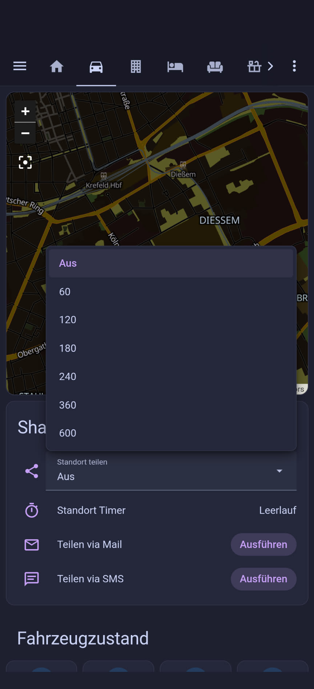

# Tesla-Standort via Tessie und Home Assistant teilen

🇬🇧 [English version → README.en.md](README.en.md)

Vor einiger Zeit habe ich einen fantastischen Roadtrip „erlebt". Es wäre schön gewesen, hätte ich meinen Standort teilen können, und zwar so, dass mein Telefon nicht gleich zu einem Glühwürfel mutiert.

Da ich – wie einige Tesla-Fahrer – Tessie nutze und liebe, liegt die Idee nahe, dessen Daten zu nutzen, um die Position zu teilen, ohne auf die rechen- und stromintensive Google-Maps-Funktion des Telefons zu setzen. Ich brauche lediglich eine Webseite, die – temporär – den Standort meines Tesla darstellt und nach Ablauf eines Timers die Anzeige wieder deaktiviert. Da Tessie das (im Moment) nicht von Haus aus bietet, und ich Home Assistant samt Tessie-Integration nutze, habe ich den Spieß einfach umgedreht.

Die ausführliche Geschichte dazu steht in meinem Blog: [Standort meines Tesla via Tessie und Home Assistant teilen](https://www.johnlose.de/2026/09/standort-meines-tesla-via-tessie-und-home-assistant-teilen/). Hier im Repo liegt der Code, damit Du ihn ordentlich kopieren, lesen und verbessern kannst.

## So sieht es aus

Bedienung im Home-Assistant-Dashboard (Dropdown mit der Freigabedauer in Minuten, Timer, Teilen-Buttons):



## So funktioniert's

```
Tesla ──► Tessie ──► Home Assistant ──POST (JSON + Geheimnis)──► update.php ──► data.json
                                                                                  ▲
                                          Freunde & Familie: index.html (Leaflet-Karte) ─┘ pollt alle 5 s
```

- **Home Assistant** startet über ein Dropdown einen Timer und schickt, solange er läuft, bei jeder Positionsänderung die GPS-Daten per `rest_command` an Deinen Webspace.
- **`update.php`** prüft das Geheimnis, bereinigt die Werte und schreibt sie in `data.json`.
- **`index.html`** zeigt die Position auf einer Karte (Leaflet / OpenStreetMap), dazu Ziel, Ankunft in Minuten und Akkustand bei Ankunft.
- Läuft der Timer ab (oder stellst Du das Dropdown auf „Aus"), wird `expired` gesendet und die Karte verschwindet sofort für alle.

## Voraussetzungen

- Home Assistant mit der **Tessie-Integration** (oder einer anderen Tesla-Integration, die Standort, Ziel und Ankunftszeit liefert)
- Eigener **Webspace mit PHP** – ein einfacher Shared-Hosting-Tarif reicht völlig

## Einrichtung

### 1. Webspace

1. Lege einen Ordner an, dessen URL Du später teilen willst, z. B. `https://DEINE-WEBSITE.de/shareloc/`.
2. Lade den Inhalt von [`webspace/`](webspace/) hoch: `index.html`, `update.php`, `data.json`.
3. Kopiere `config.example.php` nach `config.php` und trage ein **starkes, sehr langes Geheimnis** ein. Diese Datei gehört nicht ins Git (steht in der `.gitignore`).
4. Der Webserver muss `data.json` beschreiben dürfen.

### 2. Home Assistant

1. [`homeassistant/configuration.yaml`](homeassistant/configuration.yaml): Dropdown, Timer und `rest_command`. Ersetze `DEINE-WEBSITE.de`, das Geheimnis und die Entitätsnamen (`deintesla_*`) durch Deine.
2. [`homeassistant/automations.yaml`](homeassistant/automations.yaml): die zwei Automatisierungen (Timer-Steuerung und GPS-Push beim Fahren).
3. Optional [`homeassistant/dashboard-card.yaml`](homeassistant/dashboard-card.yaml): Bedienung im Dashboard samt „Teilen via SMS"-Button.
4. Konfiguration prüfen und neu laden bzw. Home Assistant neu starten.

> **Achtung:** Hast Du in der `configuration.yaml` schon einen `rest_command:`-, `input_select:`- oder `timer:`-Block, sortiere die Einträge dort ein. Ein zweiter gleichnamiger Block überschreibt den ersten – darüber bin ich selbst schon gestolpert (`service_not_found`).

## Datenschutz und Sicherheit

Das Ding dient dem, Deinen Standort anzuzeigen. Ich gehe davon aus, dass Du das so willst. Außerdem bin ich auf keinen Fall frei von Fehlern. Wähle ein starkes, sehr langes Geheimnis, das nicht schnell per Bruteforce erraten werden kann. Ich habe eingebaut, was auf einem regulären Webspace eben möglich ist (Typ-Sicherung der Eingaben, `hash_equals`, `LOCK_EX`, Escaping der Anzeige). Wenn Du Verbesserungsvorschläge hast, gerne her damit – Issues und Pull Requests sind willkommen.

Die Seite zeigt nur dann Daten, solange ein Timer läuft. Danach steht in `data.json` nur noch `{"status":"expired"}`.

## Danksagung

Kartendarstellung mit [Leaflet](https://leafletjs.com) von Volodymyr Agafonkin und den Karten von [OpenStreetMap](https://www.openstreetmap.org/copyright). Ich nutze die original [Tessie-Integration](https://www.home-assistant.io/integrations/tessie/) für Home Assistant.

## Lizenz

[Apache License 2.0](LICENSE)
